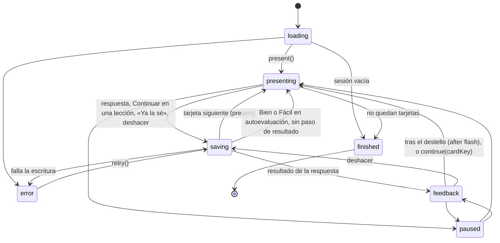
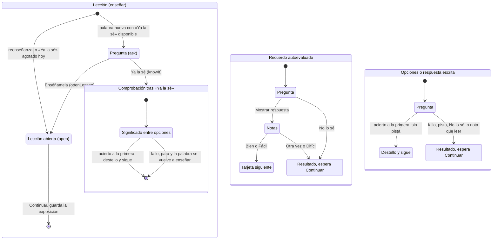

# Flujo de una tarjeta

El controlador (`apps/web/src/stores/learningSessionStore.ts`) decide en qué paso está la tarjeta que se ve. Las tarjetas (`apps/web/src/components/learning/`) pintan ese paso y avisan de lo que hace quien aprende. Ninguna tarjeta guarda un paso propio ni llama a una acción desde un efecto.

La regla tras una respuesta cabe en una frase: acertar sin ayuda nunca para, fallar siempre para.

## Estados de la sesión

Cada vez que `present()` pone una tarjeta en pantalla, `view.cardKey` cambia. Pasa con la tarjeta siguiente, con la comprobación tras «Ya la sé» y con la tarjeta que trae un deshacer. La tarjeta se vuelve a montar con esa clave y la manda con `continue`, `knowIt` y `openLesson`. El controlador ignora una clave que ya no es la de la pantalla. Así, el segundo toque de un doble toque o el final del destello que coincide con un toque no hacen nada en la tarjeta siguiente.

El destello lo lleva el controlador. Tras un acierto sin ayuda, `view.after` vale `flash`, la respuesta correcta se ve `FLASH_MS` (700 ms) y el controlador pasa a la tarjeta siguiente. Esa espera va en la cola de escrituras, así que `idle()` la incluye. Si mientras tanto se pulsa Continuar, se deshace o se pausa, no hace nada. Una sesión pausada durante el destello vuelve al resultado y espera a Continuar.

Además, durante los primeros 400 ms de cada tarjeta, `LearningCard` no deja pasar toques. Un toque rápido sobre Continuar no cae en «Enséñamela», «Ya la sé» o «No lo sé» de la tarjeta siguiente, que están en el mismo sitio.

## Pasos por tipo de tarjeta

| Tarjeta | Botones abajo | Qué pasa tras responder |
| --- | --- | --- |
| Lección `ask` (`view.lesson.mode`) | «Ya la sé» y «Enséñamela» | Nada que responder |
| Lección `open` | Continuar | Nada. Una reenseñanza (`view.lesson.again`) dice «Otra vez» y que ya la has visto |
| Comprobación tras «Ya la sé» (`view.claimedCheck`) | Opciones y «No lo sé» | Acierto: destello y sigue. Fallo: para, y la palabra vuelve como lección |
| Recuerdo, antes de mostrar | Mostrar respuesta | |
| Recuerdo, Bien o Fácil | Notas | Sin paso de resultado: la tarjeta siguiente sale ya |
| Recuerdo, Otra vez o Difícil | Notas, luego Continuar | Para con la respuesta y la ficha |
| Opciones, acierto a la primera (`view.after === 'flash'`) | «No lo sé» desactivado | Las opciones se quedan con la buena en verde 700 ms y sigue |
| Escrita, acierto exacto | «No lo sé» y «Comprobar» desactivados | La respuesta se ve 700 ms, sin ficha, y sigue |
| Escrita, acierto con nota (un tono que no cuenta, otra palabra que también vale) | Continuar | Para, para que se lea la nota |
| Cualquier fallo, pista o «No lo sé» (`view.after === 'wait'`) | Continuar | Para con la respuesta y la ficha |
| Trazos: mirar, trazar, escribir | Continuar | Para |

La ficha de una palabra acertada no se ve en el destello. Está en el vocabulario, y el botón de deshacer de la cabecera devuelve la tarjeta.

## Por qué una palabra aparece abierta

Una lección pregunta primero (`ask`) solo si es la primera vez que se enseña la palabra (`reason: 'new'`) y quedan «Ya la sé» hoy. Se abre directamente cuando:

- la palabra ya se enseñó antes sin una práctica correcta (`reteach`), o falló su práctica justo después de enseñarla (`teach-again`). La tarjeta dice «Otra vez».
- se gastaron los «Ya la sé» del día. La tarjeta lo dice.

## Lo que no puede pasar

- Una lección no se guarda sin haberse visto. Continuar solo aparece en `open`, y Espacio en `ask` abre la lección.
- Un toque, una tecla o el final del destello de la tarjeta anterior no actúan sobre la siguiente, porque llevan su `cardKey`.
- Una tarjeta nueva no se pinta con el resultado de la anterior. `present()` escribe toda la vista de una vez, con `feedback: null`.
- «Ya la sé» no escribe un Bien que no se ha ganado. La comprobación pide elegir el significado sin verlo.
- Solo hay una regla de avance, y la decide el controlador.
